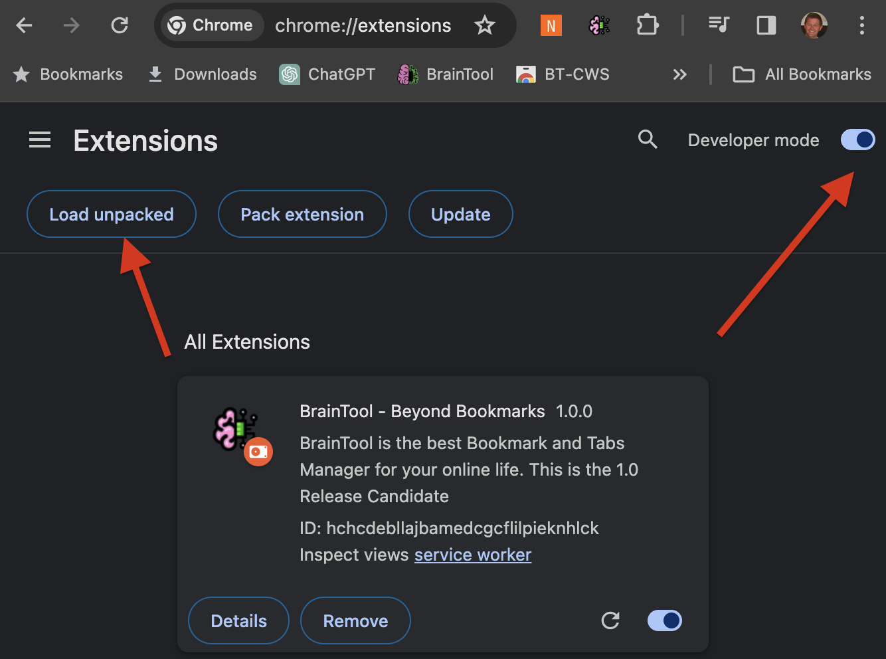

# Local Install

This page describes how to run BrainTool from its source code, for example to try out unreleased changes or to work on BrainTool itself. Most people should just install BrainTool from the [Chrome Web Store](https://chrome.google.com/webstore/detail/braintool/fialfmcgpibjgdoeodaondepigiiddio).

<!-- TODO(tony): this page was rewritten from the current source (extension/manifest.json, extension/popup.js, extension/configFallback.js). Please sanity check it against your own dev setup notes. -->

## Background
BrainTool is composed of two parts:

- The **extension** (the `extension/` folder in the repository) is installed in the browser's extension system. It owns the BT icon in the toolbar and the Bookmarker popup, listens for messages from the Topic Manager and updates tabs accordingly, and sends back event notifications when tabs and windows open or change.
- The **Topic Manager app** (the `app/` folder) is where the main logic of the application lives. The extension loads it into a window, a tab or the browser side panel.

The store version of the extension loads the app for its own release from braintool.org (released versions live under `versions/` in the repository). The extension in the repository's `extension/` folder instead loads the app from `http://localhost:8000/app/`, so a local install runs both the extension and the app from your copy of the code.

## Caution!
A local install is a separate extension from the store version, with its own preferences and in-browser data. Turn off the store version of BrainTool on your extensions page while you use the local one, so the two don't both try to manage your tabs.

Before you start, export a copy of your BrainTool data (Export under Actions). You can import it into the local install if you wish.

If you sync your data to a Google Drive or local file, use caution and keep backups so you don't lose any data. A local install can point at the same local file as your store install, but you can also create a new file in a different folder.

## Get the code
Clone the BrainTool repository with [git](https://git-scm.com/):

```bash
git clone https://github.com/tconfrey/BrainTool.git
```

The `extension/background.js` code expects a file called `extension/config.js` holding the keys for Google Drive, Firebase and Stripe. That file is not in the repository. To run without those keys, copy the fallback file:

```bash
cp extension/configFallback.js extension/config.js
```

Without real keys, Google Drive sync and Supporter licensing won't work, but everything else will. If you need to test those, email [braintool.extension@gmail.com](mailto:braintool.extension@gmail.com).
<!-- TODO(tony): confirm you still want to offer the keys file by email, as the old version of this page did. -->

## Serve the app
Run any static web server from the top level `BrainTool` folder on port 8000, for example:

```bash
python3 -m http.server 8000
```

The Topic Manager should then load at [http://localhost:8000/app/](http://localhost:8000/app/).

## Load the extension
Open your browser's extensions page: chrome://extensions, edge://extensions or brave://extensions, depending on your browser. Turn on Developer mode, click 'Load unpacked' and select the `extension` folder of your clone.



The Welcome page should open, and you can pin the BT icon from the browser's extensions menu. Click it to open the Topic Manager from your local server. After you change the extension code, click the reload button for BrainTool on the extensions page. After you change the app code, reload the Topic Manager.
