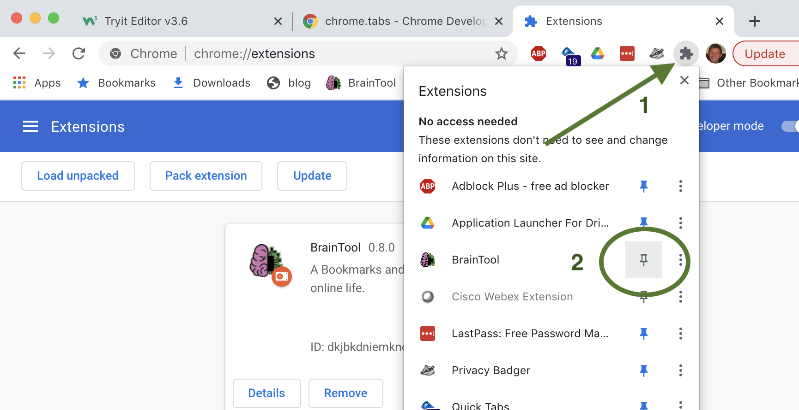

# Welcome to BrainTool!

We're very glad to have you as a new user. This page should help you get up and running on some things that might not be immediately obvious.

## Launching BrainTool

Chrome hides new extensions under the jigsaw piece icon on the top right of its window. You can pin the BrainTool icon to your browser toolbar by clicking the puzzle piece and hitting the pin next to the BT icon. 
 

Launch BrainTool by clicking the toolbar icon or using the Alt/Option-b accelerator key. Initially this opens the Topic Manager in its own window, subsequently it opens the BrainTool Bookmarker tool. The Bookmarker allows you to save the current tab, tabgroup, window, or whole session. The Topic Manager allows you to manage your topics and tabs. Hitting b twice (Opt-b-b), or double clicking the icon, will surface the Topic Manager if it's hidden.

If you'd rather not have a separate window, the Topic Manager can instead live in the browser's side panel or in a regular tab. Choose under 'Topic Manager Location' in Settings; the change applies the next time the Topic Manager is opened.

## Initial BrainTool tree
BrainTool is a ['Topic Manager'](), designed to allow you to categorize and manage all of the topics you need to keep track of. It comes with an example organizational hierarchy to give you an idea of how it can be used. Any of those contents may be deleted. It's up to you to create your own hierarchy. Some people like a big list of minimally organized folders, others go for a deep categorization of nested topics.

## Your current session
Alongside your topics the Topic Manager shows a live 🌐 CURRENT SESSION tree of the browser windows, tab groups and tabs you have open right now. It updates as you open, move and close tabs.

- Drag a topic into the session tree to open it.
- Drag a tab or tab group from the session tree onto a topic to save it there, or to re-file something you've already saved.

If you don't want to see the session tree, delete its top row (this just closes the session view, not your tabs) or set 'Session Manager?' to No in Settings. Set it back to Yes to bring it back.

<!-- TODO(tony): add a screenshot of the CURRENT SESSION tree here once there's a 1.4 asset. -->

## Support and more Info
Ideally BT is intuitive to use but it's pretty feature rich and not everything is obvious (for example [keyboard accelerators](/support/userGuide.html#keyboard-accelerators)), so at least skim the [User Guide](/support/userGuide.html) and check out this [playlist of short videos](https://www.youtube.com/playlist?list=PLhaw8BE1kin3QoDaTxVXhO406kswXYlLF). For troubleshooting see the [Support page](/support.html). If that does not help reach out on the [Discussion Group](https://groups.google.com/u/2/g/braintool-discussion). To see the changes in the latest release see the [Release Notes page](/support/releaseNotes.html). The User Guide is also saved for you under the Resources topic in your starter BrainTool tree.

<!-- TODO(tony): the video playlists predate 1.4 and don't show the Session Manager or session drag and drop. Update the playlist, or say here that the videos show an earlier version. -->
<!-- TODO(tony): is the older 'earlier version' playlist below still worth linking from the page every new user sees? -->
There's also an older [YouTube Playlist](https://www.youtube.com/watch?v=6JGdPIenO38&list=PLhaw8BE1kin1D9uPrY9yF-KoBoWisbBaP&index=1) with a few examples of an earlier version of BrainTool (BT) in use.

## Security and Permissions
The BrainTool philosophy is to have the absolute minimum set of permissions and data access necessary to maintain your braintool organizer file and perform browser actions on your behalf; and to be completely transparent about what it's doing. Your BrainTool data is stored on the browser locally and, optionally, in a synced plain text file ([org-mode](https://orgmode.org) format), locally or on a Google Drive file. All of the BT extension and application code are open sourced on [github](https://github.com/tconfrey/BrainTool).
